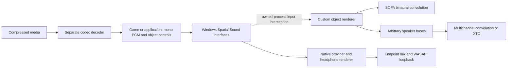

# Windows Spatial Audio Research

This project documents where Windows spatial audio objects can be captured, how they can be rendered to headphones or speakers, and what information a stereo mix retains. It includes offline examples for Windows Spatial Sound, headphone personalization, SOFA, multichannel PCM, and crosstalk cancellation.

To reproduce the offline checks, start with [Run the examples](#run-the-examples). For experiment results and their limits, see [What the tests showed](#what-the-tests-showed) or the [full research status](RESEARCH_STATUS.md).

Windows spatial clients submit PCM and object controls. A custom renderer can process both before mixing. The resulting stereo signal cannot uniquely identify the original object scene. Compressed-media decoding is a separate step.



## Run the examples

From the repository root, run the offline checks with Python 3.10 or later. To build the native examples on Windows x64, install Visual Studio C++ tools and a Windows SDK. The build scripts locate both automatically from their installation metadata.

```powershell
python -m pip install -r requirements.txt
python -m unittest discover -s tests -v
python tools/generate_fixtures.py
python tools/run_examples.py
```

The default runner works offline. Use the [example guide](examples/README.md) to run the separate native-library or live capture tests. The native-library tests use local, version-pinned DLLs. Live capture uses the current default render endpoint and requires spatial support. It leaves providers, defaults, installed effects, and endpoint settings unchanged.

## What the tests showed

| Topic | Established scope | Remaining limit |
|---|---|---|
| Input before binauralization | Real Windows spatial calls forwarded through an owned producer's COM wrappers; exact PCM, position, gain and object lifetimes retained | Arbitrary games, all interface variants and concurrent COM lifecycles |
| Custom Sonic DSP | Unmodified private HrtfApo selects a custom COM DSP through nonzero-GUID and default zero-GUID routes; full SOFA filtering matches independent convolution | Actual system-host admission, endpoint isolation and restoration |
| Object-to-speaker rendering | Native VBAP produces 4/8/16/24/32 speaker buses; explicit lifetime changes retain earlier convolution tails | Complete live device-clocked output application |
| Sixteen-channel Equalizer APO | Actual captured object PCM passes a native panner and the installed APO DSP against an independent complete-tail reference | A custom live FIFO/sink and suppression of duplicated native audio |
| DTS decoding | Complete available channel-based DTS-UHD fixture decoded to ordinary multichannel PCM without HDMI | Original moving objects and other syntax/profile coverage |
| DTS personalization and room | Preserve personalized FIRs while restoring compatible native recursive-room sends | Version-specific assets, formats and runtime compatibility |
| Dolby personalization and room | Endpoint-property delivery affects native object-rendered output; room/direct fields mapped separately | Consumer UI/cache import, arbitrary versions and acoustic personalization claims |
| XTC | Native full-filter processing matches synthetic references | Physical cancellation requires measured speaker-to-ear paths |

The native engine tests ran in an isolated process. The crosstalk tests used synthetic speaker-to-ear paths. Decoder CPU timings measure processing time only. See the [research status](RESEARCH_STATUS.md) for the conditions behind each result.

## Read the research

1. [Windows audio architecture and object contracts](docs/topics/01-architecture.md)
2. [Object input, identity and interception](docs/topics/02-object-input.md)
3. [Sonic coefficient paths and DSP replacement](docs/topics/03-sonic-renderer.md)
4. [Dolby profile storage, framing and coefficient loading](docs/topics/04-dolby-profiles.md)
5. [Dolby room processing and coefficient-to-SOFA limits](docs/topics/05-dolby-room-and-coefficients.md)
6. [DTS personalization and native room presets](docs/topics/06-dts-personalization.md)
7. [DTS decoding, object extraction and PCM transport](docs/topics/07-dts-decoding.md)
8. [Virtual SOFA measurement and export](docs/topics/08-sofa-measurement.md)
9. [Sixteen-channel rendering and Equalizer APO](docs/topics/09-multichannel-convolution.md)
10. [Crosstalk cancellation](docs/topics/10-crosstalk-cancellation.md)
11. [Latency, clocks and real-time limits](docs/topics/11-latency.md)
12. [Reverse-engineering methods and evidence](docs/methods/README.md)
13. [Research history reconstructed from saved summaries](docs/history.md)
14. [Detailed archived findings](docs/ARCHIVE_INDEX.md)

The archive contains anonymized research notes, including abandoned approaches and corrected interpretations. It is historical evidence. The public examples use synthetic fixtures and have their own validation record.

## Public data and provenance

The published materials include synthetic fixtures, source examples, and anonymized research notes. Technical class and interface identifiers and version-pinned vendor binary hashes document loading requirements. See the [validation record](VALIDATION.md) for the publication checks.

The examples run in the scopes described above and leave system files and installed APOs unchanged. [Source index](docs/SOURCE_INDEX.json), [validation](VALIDATION.md), [primary references](docs/REFERENCES.md), and [release notes](CHANGELOG.md) describe the public snapshot.
