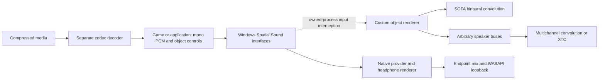

# Windows Spatial Audio Research

Research and reproducible examples for Windows Spatial Sound, object rendering, headphone personalization, SOFA, multichannel PCM, and crosstalk cancellation.

The central distinction is between **access to source objects**, **rendering those objects**, and **decoding compressed media**. Windows spatial clients submit PCM and object controls. A custom speaker or headphone renderer can process those objects before mixing; a stereo loopback cannot uniquely recover the original arbitrary scene afterward.



## Results

| Topic | Established scope | Remaining limit |
|---|---|---|
| Input before binauralization | Real Windows spatial calls forwarded through an owned producer's COM wrappers; exact PCM, position, gain and object lifetimes retained | Arbitrary games, all interface variants and concurrent COM lifecycles |
| Custom Sonic DSP | Unmodified private HrtfApo selects a custom COM DSP through nonzero-GUID and default zero-GUID routes; full SOFA filtering matches independent convolution | Actual system-host admission, endpoint isolation and restoration |
| Object-to-speaker rendering | Native VBAP produces 4/8/16/24/32 speaker buses; explicit lifetime changes retain earlier convolution tails | Complete live device-clocked output application |
| Sixteen-channel Equalizer APO | Actual captured object PCM passes a native panner and the installed APO DSP against an independent complete-tail reference | A custom live FIFO/sink and suppression of duplicated native audio |
| DTS decoding | Complete available channel-based DTS-UHD fixture decoded to ordinary multichannel PCM without HDMI | Original moving objects and other syntax/profile coverage |
| DTS personalization and room | Preserve personalized FIRs while restoring compatible native recursive-room sends | Version-specific assets, formats and runtime compatibility |
| Dolby personalization and room | Endpoint-property delivery affects native object-rendered output; room/direct fields mapped separately | Consumer UI/cache import, arbitrary versions and acoustic personalization claims |
| XTC | Native full-filter processing matches synthetic references | Physical cancellation requires measured speaker-to-ear paths |

These are deliberately scoped findings. A private engine is not the Windows audio service, a synthetic plant is not an acoustic test, and a decoder CPU time is not end-to-end latency. See [research status](RESEARCH_STATUS.md).

## Read the research

1. [Windows audio architecture and object contracts](docs/topics/01-architecture.md)
2. [Object input, identity and interception](docs/topics/02-object-input.md)
3. [Sonic coefficient paths and DSP replacement](docs/topics/03-sonic-renderer.md)
4. [Dolby profile storage, framing and coefficient loading](docs/topics/04-dolby-profiles.md)
5. [Dolby room processing and coefficient-to-SOFA limits](docs/topics/05-dolby-room-and-coefficients.md)
6. [DTS personalization and native room presets](docs/topics/06-dts-personalization.md)
7. [DTS decoding, object extraction and PCM transport](docs/topics/07-dts-decoding.md)
8. [Virtual SOFA measurement and export](docs/topics/08-sofa-measurement.md)
9. [Sixteen-channel rendering and Equalizer APO](docs/topics/09-multichannel-convolution.md)
10. [Crosstalk cancellation](docs/topics/10-crosstalk-cancellation.md)
11. [Latency, clocks and real-time limits](docs/topics/11-latency.md)
12. [Reverse-engineering methods and evidence](docs/methods/README.md)
13. [Research history reconstructed from saved summaries](docs/history.md)
14. [Detailed archived findings](docs/ARCHIVE_INDEX.md)

The archive contains anonymized research notes, including abandoned approaches and corrected interpretations. It is historical evidence. The public examples use synthetic fixtures and have their own validation record.

## Run the examples

Python 3.10+ with the packages in `requirements.txt` is sufficient for the offline Python checks. Windows x64 native examples additionally require Visual Studio C++ tools and a Windows SDK. The scripts locate those tools through their standard installation metadata.

```powershell
python -m pip install -r requirements.txt
python -m unittest discover -s tests -v
python tools/generate_fixtures.py
python tools/run_examples.py
```

The default example runner opens no audio stream. Optional native-library experiments load local version-pinned Windows/vendor DLLs in owned processes; those files are not distributed. Live examples select the current default render endpoint, require existing spatial support, and are explicitly invoked separately. They do not select providers, change defaults, install effects or write endpoint settings. See the [example guide](examples/README.md).

## Public data and provenance

The repository contains no personal headphone profile, measured personal HRIR array, recording, endpoint inventory, machine registry dump, vendor binary, debugger installer or Ghidra database. Technical class/interface identifiers and version-pinned vendor binary hashes remain where they are necessary to describe a loading contract. Device-instance identifiers and private artifact hashes were removed.

The code here is research code, not a system-wide renderer installer. No example silently installs an APO or replaces a system file. [Source index](docs/SOURCE_INDEX.json), [validation](VALIDATION.md), [primary references](docs/REFERENCES.md), and [release notes](CHANGELOG.md) describe the public snapshot.
