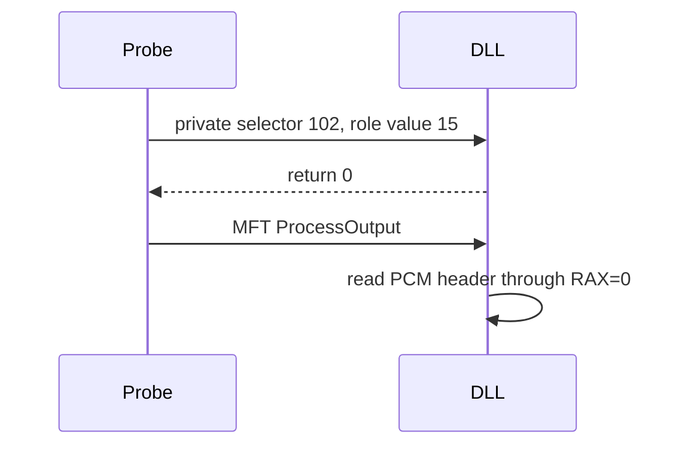

> Historical research note. Workspace instructions and artifact references below describe the original experiment; use the public agent-handoff.md for continuation.

> Anonymized archived research note. Experimental results are historical, not rerun by publication. See the current research status and public examples for supported reproduction. Local links and fixture-specific commands were removed.

# Private decoder configuration exception

## Analysis

This is an x64 first-chance user-mode access violation in a separately launched probe process using the pinned DTSXDecoder.dll. The debugger transcript is `private_layout_crash_debug.log`; the exact caller source is retained as `quarantine/private_layout_probe.cpp`. Its private_51 mode computes an internal wrapper pointer from the MFT interface and calls RVA 0x1ab30, selector 102, with packed-role value 15. This is an unsupported private-interface experiment, isolated from the default probe. The library returned zero, then output processing faulted. Matching vendor symbols and an SDK ABI/configuration contract are unavailable. Windows debugger version is 10.0.29661.1004. No dump, allocation history or TTD history was captured.

## Root Cause

The immediate failure is VERIFIED: `.exr -1` gives exception `0xc0000005`, read access, address zero, at DLL RVA `0x14372`. The stopped thread has RAX=0 and executes `mov ecx,dword ptr [rax]`. The subsequent comparison is with 0x18 (24-bit PCM). The enclosing MFT output path expects a valid internal PCM-frame header; that invariant was violated. The origin of the missing header is UNVERIFIED. It may be misuse of the private ABI/lifecycle or a mismatch between wrapper configuration and decoder state. This is not a proven vendor root-cause defect.

## Fix

No corrective fix to the private decoder path is established. The working default probe uses Media Foundation type negotiation and rejects private modes before loading the DLL. This containment preserves the independently verified spatial-ten and packed-PCM-twelve routes; it does not repair or validate private configuration. Before a new private experiment, establish the context type, selector packing, valid states, reset/reinitialization sequence and wrapper allocation obligations. Preserve the current source and trace rather than repeat an unchanged fault.

## Reasoning Chain

OBSERVE: the retained caller issues selector 102 after begin/start; return code is zero. The debugger stops at the null read in the output wrapper. HYPOTHESIZE: the unverified configuration/lifecycle invalidates or suppresses a frame expected by that wrapper. TEST: `.exr -1`, `.ecxr`, stack, registers and disassembly were requested; raw output is retained. EVALUATE: fault and invalid header use are direct evidence, but no recorded write establishes how the header became null. CONCLUDE: candidate-pending-verification for causal attribution; the supported MFT paths remain operational in new instances.

## Alternatives Considered

- Private ABI or lifecycle mismatch: strongest unresolved candidate because the call bypasses a supported interface, and selector/state meaning is incomplete. Return zero alone does not prove the wrapper is ready for the new layout.
- Wrapper/core configuration mismatch: a role selector may be valid for an inner decoder while the surrounding MFT still expects a different allocation or output representation. Getter/format changes and reinitialization obligations are unknown.
- Decoder implementation defect or unrelated corruption: possible, but no supported SDK call sequence or earlier-writer trace isolates it. The safe new-instance MFT cases pass, so the fault cannot be generalized to every DTS decode route.

## Trigger Verification

| Evidence | State | Implication |
|---|---|---|
| Private selector call in preserved source and transcript | VERIFIED observed | Selector 102, packed role mask 15, returned zero before the exception |
| `.exr -1`, current registers, instruction and stack | VERIFIED observed | Null read at RVA 0x14372 through RAX=0, called from DLL+0x13421 then probe |
| `.ecxr` | Missing context recovery | Live first-chance context request returned HRESULT 0x8000FFFF; the current stopped exception thread's registers/instruction are retained instead |
| Disassembly starting RIP-0x10 | Partial | Initial bytes may start inside an instruction; the exact RIP instruction and following comparison decode consistently |
| Successful safe MFT cases in new processes | Contradictory to a universal decoder failure | Spatial-ten and PCM6/10/12/16 prefix decode remain valid |
| Vendor symbols, supported private contract, earliest invalid-state transition | UNVERIFIED missing | Cannot attribute a vendor bug or claim the private interface is impossible |
| Fix validation | UNVERIFIED for private route | No repair claimed; safe executable excludes private mode and passes its own route checks |

## Mermaid



## Contrarian Verdict

Independent bundled Copilot contrarian review did not run because that host agent is unavailable. The attribution is CHALLENGED by the unverified ABI/lifecycle contract and remains pending. This is an explicit limitation, not a substituted independent self-review. contrarian_loopback: false.

## JSON Output Contract Summary

```json
{
  "diagnosis_status": "candidate-pending-verification",
  "routing_path": "windbg-diagnostic-method + windbg-user-exception-triage",
  "root_cause": "Immediate null frame-header read verified; origin of invalid state unresolved after unsupported private configuration",
  "confidence": 0.35,
  "fix_confidence": 0.0,
  "fix_code_path_coverage": "not-read",
  "fix": null,
  "contrarian_review": "not-run-host-unavailable; attribution challenged",
  "contrarian_loopback": false
}
```
