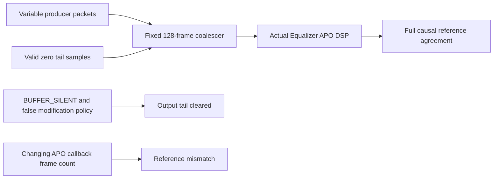

> Historical research note. Workspace instructions and artifact references below describe the original experiment; use the public agent-handoff.md for continuation.

> Anonymized archived research note. Experimental results are historical, not rerun by publication. See the current research status and public examples for supported reproduction. Local links and fixture-specific commands were removed.

# Equalizer APO callback contract investigation

## Analysis

Actual Equalizer APO 1.4.2.0 was instantiated in an owned native COM host. Sixteen-channel fixed-quantum convolution matches independent direct convolution; two altered transport conditions do not. The tests and debugger are confined to this process. No live endpoint or master configuration change was part of this investigation.

## Root Cause

Two distinct conditions explain the tested differences. The research host fails closed on installed-endpoint registry lookup, leaving `allowSilentBufferModification=false`. The APO processes a silent input but then clears its output when that policy is false. This deliberately removes any FIR tail. In the other condition, the ConvolutionFilter's internal FFT partition length is established at initialization (or the first process call if it is smaller). Subsequent frame counts are not used to rebuild/adapt that partition. Alternating block sizes therefore violates the effective convolution transport contract. The present source corroborates both behaviors; its checkout is not asserted to be a bit-for-bit build of the installed DLL.

## Fix

For this isolated transport, submit valid zero PCM while the FIR tail remains, and coalesce variable input packets into one fixed APO quantum. `fixed_quantum.h` is preallocated, checks extent multiplication and conserves sample order. The caller explicitly supplies end padding/tail zeros. A live sink additionally requires an output FIFO and queue accounting; that component is not claimed by this fix.

## Reasoning Chain

OBSERVE the fixed-size reference agreement, TEST each transport condition independently, and EVALUATE the restored stream against the same reference.

The pinned installed DLL SHA-256 is `fb73fc8b94f271464ae4f83918bb3cb3243c4f50a8035c07fa538ad16ad66aa4`. Its real APO RT vtable reports RVA `0x70000`. The corrected WinDbg-engine script hits that RVA with the expected connection count, signature and 128-frame input extent (`debug_verified.log`). Native fixed-size references pass; the silent-flag and changing-size variants fail with an approximately 0.025 maximum reference error and intact external buffer guards. The same source timeline passed after constant-quantum packet coalescing and valid-zero tail delivery. This supports a specific processing-contract explanation without requiring a claim of heap corruption, system configuration failure or acoustic behavior.

## Alternatives Considered

1. Incorrect IR channel ordering or matrix flattening would also corrupt fixed-quantum results. Independent full sixteen-input/two-ear convolution passes, so it does not explain the isolated transport differences.
2. Out-of-bounds output writing could corrupt the reference stream. External canaries remain unchanged; this rules out the tested outer extents but does not replace full heap instrumentation.
3. Every Equalizer APO install might suppress silent tails. Contradictory source evidence is the `allowSilentBufferModification=true` path, which retains nonzero output and marks it valid. The current experiment does not test the user's effective endpoint policy.

## Trigger Verification

| Condition | Status | Evidence |
|---|---|---|
| Real installed DSP called | VERIFIED | Corrected breakpoint at actual RT vtable RVA |
| Constant quantum and valid-zero tails | VERIFIED | Independent complete causal references |
| Live device transport and latency | UNVERIFIED | No device stream in this experiment |

Observed: `tail_valid_zeros` passes; `tail_silent_flag` suppresses the delayed test tap; `varying_quantum` and `varying_small_first` differ from the causal reference; `adapted_packets_and_tail` passes. `results_final_reviewed/result.json` retains all nineteen cases rather than suppressing the counterexamples. Native source `source/EqualizerAPO/EqualizerAPO.cpp` was read at APOProcess, including both silent-buffer policy branches; `source/filters/ConvolutionFilter.cpp` was read through initialization and processing. The corrected debugger trace identifies actual DLL execution, not just configuration parsing.

Contradictory evidence: ordinary fixed quanta from 48 through 1,024 frames all work when held constant, and the true silent-modification policy exists. Thus neither arbitrary producer packet sizes nor tails are inherently impossible.

Missing: a live installed endpoint trial of this exact adapter, output FIFO/clock transport, full heap instrumentation and end-to-end acoustic/device latency. These are outside the proven fix.

Fix validation: sixteen positive references, three intentional counterexamples, six native VBAP references and the full SOFA matrix chain pass their expected assertions. Independent review found and verified the checked-allocation and cleanup fixes. The fixed-quantum overflow probe now rejects invalid dimensions. The master hash matches within each corrected APO run.

## Mermaid



## Contrarian Verdict

The bundled Copilot contrarian agent is not available in this host, so that prescribed independent review did not run and no loopback is claimed. A separate 6.1 Sol peer reviewed the actual host, coalescer, VBAP source and references in `../sofa_xtc_runtime/eqapo_review/review.md`. Its corrections were applied and rerun. That review is disclosed separately rather than silently substituted for the unavailable agent.

No ACCEPTED or CHALLENGED verdict was returned by the unavailable agent. contrarian_loopback: false.

## JSON Output Contract Summary

```json
{
  "diagnosis_status": "verified_for_isolated_transport",
  "routing_path": "owned COM host -> pinned Equalizer APO RT -> independent reference",
  "root_cause": "Research-host false silent-modification policy clears tails; changing callback lengths do not match the initialized convolution partition.",
  "confidence": 0.94,
  "fix_confidence": 0.93,
  "fix_code_path_coverage": "read-this-session",
  "contrarian_review": "Bundled Copilot agent unavailable; separate disclosed source peer review completed.",
  "contrarian_loopback": false
}
```
