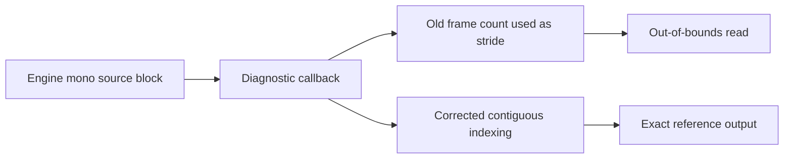

> Historical research note. Workspace instructions and artifact references below describe the original experiment; use the public agent-handoff.md for continuation.

> Anonymized archived research note. Experimental results are historical, not rerun by publication. See the current research status and public examples for supported reproduction. Local links and fixture-specific commands were removed.

# Isolated Sonic engine probe: source-buffer ABI correction

## Analysis

WinDbg/CDB 10.0.29661.1004 launched only the new `sonic_engine_probe.exe`, with inert matching HrtfApo/HrtfDspCpu copies. The initial diagnostic callback raised first-chance access violation `c0000005` at probe RVA `0x5a44`, while reading `[rax+rcx*4]`. The stack returned through HrtfApo's engine render routine. This was a fault in the new probe, not evidence of a Windows renderer defect. The exception record and register context are retained in `../windbg_engine_custom_dsp/debug.log`; `.ecxr` could not retrieve a separate exception context, but the stopped registers and stack were available.

## Root Cause

The callback treated offset 112 in the 120-byte private source structure as an input stride and indexed `samples[i * field112]`. The actual engine supplied 1,024 at that offset for its 1,024-frame mono buffer. This interpretation read beyond the buffer. The violated invariant was contiguous, bounded access to one source block.

## Fix

The corrected callback reads contiguous `samples[i]`, names the field `frameCount`, and requires it to equal the render frame count. Both Sonic probes now pass the actual frame count. The isolated native CPU responses and engine diagnostic were rerun. The replacement filter output matched every expected float sample; the corrected run also completed under CDB without an access violation. The current sources are `../tools/sonic_engine_probe.cpp` and `../tools/sonic_dsp_probe.cpp`.

## Reasoning Chain

1. Observed faulting instruction indexed from the mono source pointer in the diagnostic callback.
2. The callback multiplied its index by offset 112; a subsequent native observation showed that field equals the 1,024-frame block length.
3. Reading consecutive mono float samples restored the expected transfer: left impulse at frame 3,072, right impulse at frame 3,079 with −0.5 relative gain.
4. Twelve engine calls and the complete output matched the reference. CDB repetition also completed successfully.

## Alternatives Considered

- Invalid engine input array: the same source-buffer layout rendered successfully through the unmodified native DSP; the fault occurred in the custom callback's indexing.
- Wrong DSP callback argument order or source size: observed frame/source counts and the PCM pointer were coherent, and the corrected callback reproduced the complete expected output.
- A corrupted native DSP instance: its method table was restored before release, and repeated default/custom engine creation completed after the callback correction.

## Trigger Verification

| Evidence | Status | Observation |
|---|---|---|
| Initial fault | VERIFIED | CDB exception record, stopped registers, bad read and callback/engine stack retained. |
| Field interpretation | VERIFIED for tested ABI | Engine supplied 1,024 at offset 112 for a 1,024-frame source. Static engine processing and corrected native runs agree. |
| Contradictory evidence | None observed | Native engine rendering completed before the old callback's invalid read. |
| Fix validation | VERIFIED | Exact diagnostic PCM and 12 custom calls, both directly and under CDB. |
| Wider compatibility | UNVERIFIED | Other binary versions, source layouts and production integration were not tested. |

## Mermaid



## Contrarian Verdict

Independent bundled contrarian review did not run: this host exposes no runner for that Copilot agent. Neither an ACCEPTED nor a CHALLENGED independent verdict was issued. The second-pass source review and repeated native tests are separate from independent review. `contrarian_loopback: false`.

## JSON Output Contract Summary

```json
{
  "diagnosis_status": "verified",
  "routing_path": "isolated-user-mode-probe-access-violation",
  "root_cause": "Private source frame count misinterpreted as stride in the new diagnostic callback",
  "confidence": 0.98,
  "fix_confidence": 0.98,
  "fix_code_path_coverage": "read-this-session",
  "contrarian_review": "not-run-host-runner-unavailable",
  "contrarian_loopback": false
}
```
